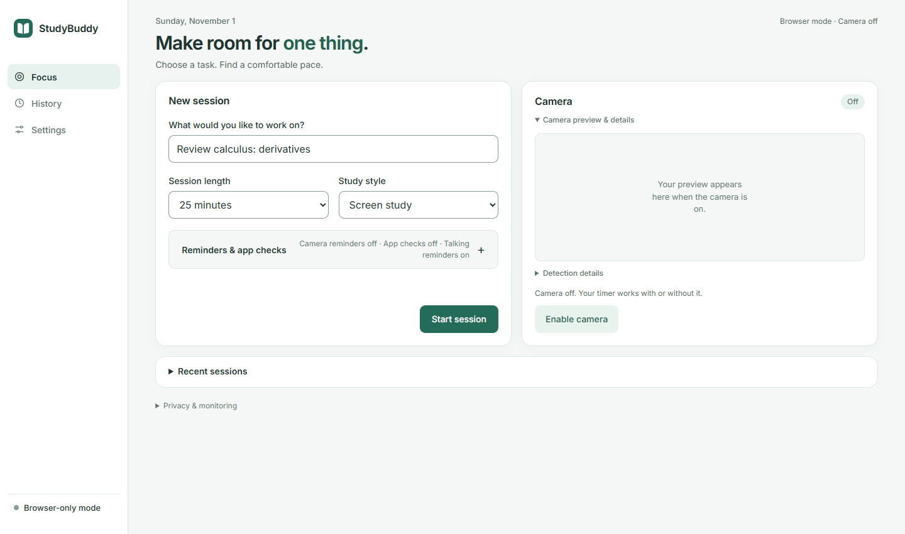
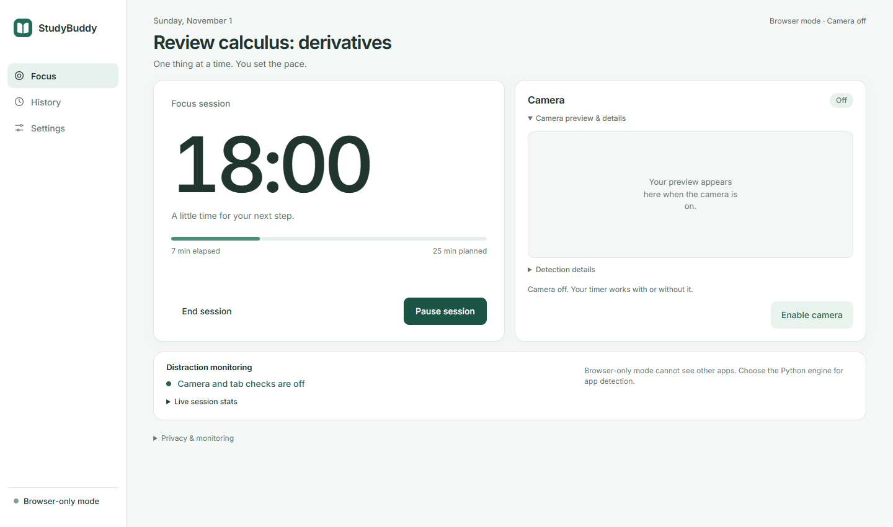
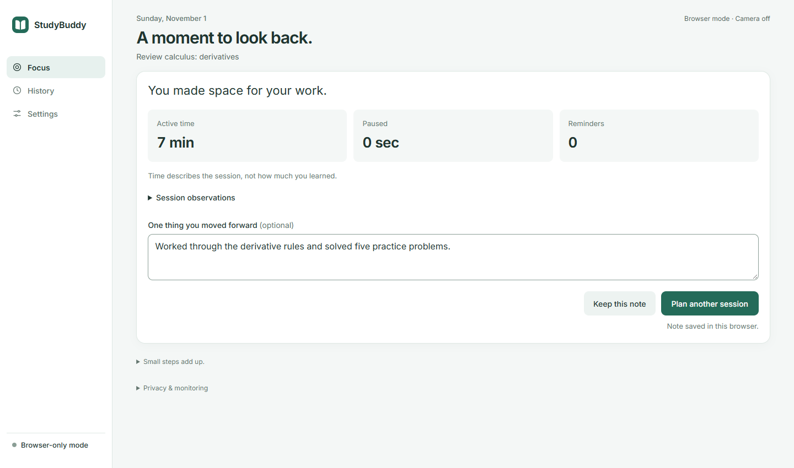
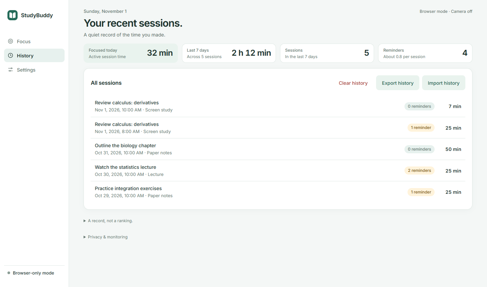
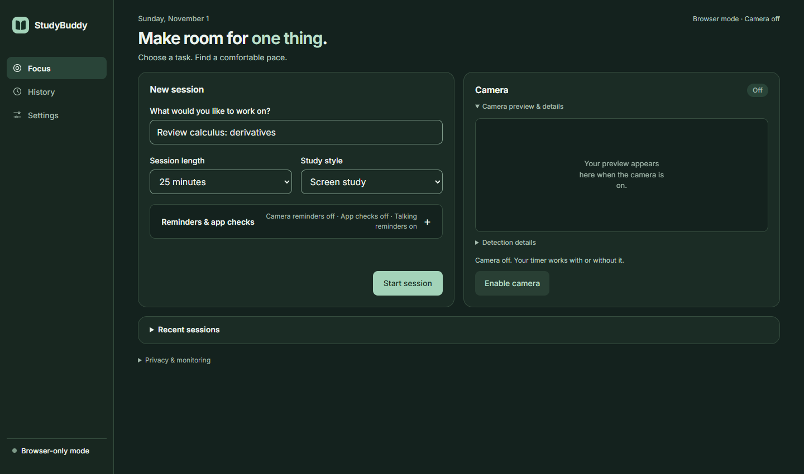
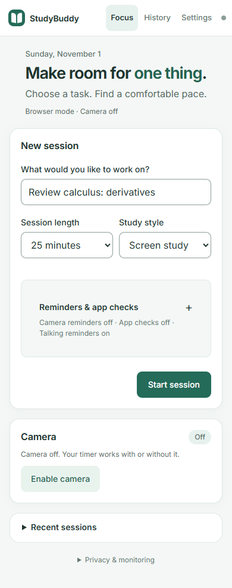

# StudyBuddy

**Make room for one thing.**

A study workspace that brings together a focus timer, local distraction reminders, and a clear record of your sessions. Choose a task, work at your own pace, and review what you moved forward.

[](https://github.com/Jomesly/StudyBuddy/actions/workflows/ci.yml)




[Getting started](#getting-started) · [System tour](#system-tour) · [Monitoring modes](#monitoring-modes) · [Build and verification](#build-and-verification)

## What you can do

- **Plan focused work.** Name a task and choose a 15-, 25-, or 50-minute session, followed by a five-minute break.
- **Match your study style.** Screen study, paper notes, and lecture modes adjust reminders to the work you are doing.
- **Keep the timer in view.** Pause, resume, or end a session alongside the camera controls.
- **Use local monitoring.** Combine camera observations and Windows foreground application checks, or choose browser-only mode.
- **Control reminders.** Choose a minimum interval, keep reminders silent, snooze for five minutes, or allow specific apps and sites for a task.
- **Review your progress.** Save reflections, inspect observations, and see daily and weekly active-time totals.
- **Back up your history.** Export and import JSON, with validation and duplicate handling that preserves existing notes.
- **Choose your appearance.** Light, dark, and system themes work across desktop, tablet, and phone layouts.

## System tour

These screenshots show the running interface with sample study data in browser-only mode. Camera capture is off; no personal camera images are included.

### 1. Set a task

The workspace above keeps the study goal, session length, and study style together. Reminder settings expand when needed, and the camera has separate preview and capture controls.

### 2. Work with a visible timer

The active session displays remaining time, progress, and direct Pause and End actions. Paused time is tracked separately from active time.



### 3. Reflect on the session

The recap separates active time, paused time, and reminders. Add a short reflection and inspect observations without treating them as a measure of learning.



### 4. Review and back up your history

History brings recent sessions and weekly totals into one view. Open a session to revisit its reflection, export a backup, or import an existing StudyBuddy export.



### 5. Choose a comfortable appearance

Dark mode preserves the same layout and controls. Smaller screens put the setup form first and the camera panel below it.



<details>
<summary>View the mobile layout</summary>
<br>

</details>

## Getting started

### Requirements

- **Node.js 22.12 or later**, with npm.
- **Python 3.11** for the full local engine. On Windows, it must be available through `py -3.11`.
- **Google Chrome or Microsoft Edge** is recommended for camera access.
- **Windows** is required for foreground application monitoring and named DirectShow camera selection.
- Internet access for the initial dependency and detection-model downloads.

### Install and launch

```powershell
git clone --branch main https://github.com/Jomesly/StudyBuddy.git
cd StudyBuddy
npm ci
npm run dev
```

Open **http://127.0.0.1:5174/**. Keep the terminal running; **Ctrl+C** stops the website and local engine. For later launches, run `npm run dev` from the project folder.

The launcher starts both services, prepares Python dependencies when necessary, and verifies the engine through the same API proxy used by the page. It uses an existing Python 3.11 `venv`, or creates `.venv-web`. On other platforms it uses `python3`; use Python 3.11 for compatibility with the pinned MediaPipe package. Rename an incompatible `.venv-web` as a backup before retrying.

The first install downloads browser models and WebAssembly assets. The Python detector downloads the standard `yolov8n.pt` model on first use if absent. Model weights, generated assets, and virtual environments are excluded from source control. If browser downloads fail, run `npm run models` to retry.

### Your first session

1. Enter a specific task, then choose a session length and study style.
2. Check the camera panel. Python mode starts with the camera switch enabled for preview; use **Turn camera off** to work without it.
3. Expand **Reminders & app checks** to choose monitoring options and allowed apps or sites.
4. Select **Start session**. Pause when needed, or finish early with **End session**.
5. Add a reflection to the recap. Open **History** to review sessions or export a backup.

**Settings** controls appearance, detection engine, reminder interval, and sound. Camera permissions require localhost or HTTPS in browser-only mode.

## Monitoring modes

| Capability | Original Python engine | Browser only |
| --- | --- | --- |
| Timer, breaks, notes, history, and backups | Yes | Yes |
| Face presence, head direction, and hands | Local MediaPipe | Local MediaPipe worker |
| Phone detection | YOLOv8 | EfficientDet Lite |
| Optional mouth movement observations | Local heuristic | Local heuristic |
| Foreground application checks | Windows window titles | Unavailable |
| Monitoring after switching tabs | Local engine continues | Tab-away reminders; camera analysis suspends |
| Camera selection | Native devices; named on Windows | Browser devices, subject to permission |

**Original Python engine** is the default. It runs at `127.0.0.1:8766`; the interface connects through `/api` on port `5174`. Capture and inference run separately so slower detection does not directly limit preview refresh to its analysis rate. Actual FPS depends on hardware, lighting, and drivers.

**Browser only** can run without Python:

```powershell
npm run dev:web
```

Select **Settings → Detection engine → Browser only**. The timer works with the camera off. Camera analysis uses a worker and locally served model assets.

### Session continuity and recovery

- Pause, End, and planned breaks release capture. Resume restores it only if enabled for the current visit.
- One browser tab owns the active Python session. A live session cannot be taken over by another tab.
- Closing the owner tab releases ownership. After a crash or disconnection, ownership expires after two minutes without a heartbeat and active time pauses. Another tab can then select **Recover session**, with the camera off.
- After an engine restart, the browser preserves its last saved progress and pauses the session. Resume continues from that snapshot; End saves a recap. An abrupt crash can lose time since the most recent snapshot.
- History retains up to 500 sessions. Imports accept completed sessions from backups of up to 10 MB and 500 records, validate the entire file before merging, and preserve existing notes on duplicate session IDs. Invalid files or storage failures leave existing history intact.

## How the system works

The web interface manages session controls, preferences, notes, and local history. In Python mode, a FastAPI service owns the active clock, captures frames with OpenCV, runs detection, and checks the foreground window on Windows. In browser-only mode, the browser owns the clock and a dedicated worker runs camera analysis.

| Component | Responsibility |
| --- | --- |
| Web interface | Task setup, timer controls, preview, recap, history, and settings |
| Vite | Local web server, production build, and API proxy |
| FastAPI service | Session ownership, camera lifecycle, engine state, and controls |
| OpenCV, MediaPipe, and Ultralytics | Native capture and visual observations |
| Browser vision worker | MediaPipe tasks and EfficientDet Lite detection |
| Browser storage | Session snapshots, preferences, history, and reflections |

### Privacy and measurement

Camera frames are processed locally, with no cloud video upload, video recording, or microphone use. Python previews travel between the local engine and browser. Windows application checks read visible foreground window titles; they do not read browser history. Initial dependency and model downloads require network access.

History, reflections, and preferences stay in the current browser profile. There are no accounts or cloud synchronization. Use History to export or delete data; exports contain your task names and notes.

Detection is heuristic. Lighting, camera placement, occlusion, and device performance affect results. Phone visibility does not prove use, and mouth movement does not establish speech. Active time and estimated observations do not measure attention, learning, or academic performance.

## Build and verification

```powershell
npm test
npm run test:e2e
npm run build
```

For Python checks, use the environment selected by the launcher:

```powershell
.\venv\Scripts\python.exe -m pip install -r requirements-dev.txt
.\venv\Scripts\python.exe -m backend.check_runtime
.\venv\Scripts\python.exe -m pip check
.\venv\Scripts\python.exe -m unittest discover -s tests/python -v
```

If the launcher created `.venv-web`, replace `venv` in these commands with `.venv-web`.

Browser tests use installed Google Chrome locally. CI installs Chromium and runs on Windows with Python 3.11. The [Checks workflow](.github/workflows/ci.yml) verifies JavaScript tests, Python tests, runtime imports, package compatibility, the production build, and browser flows. Camera flows use simulated streams and API responses instead of physical cameras.

Worker code is compiled before `dev` and `build`; restart the development server after changing it.

### Production build and hosting

`main` is the primary system branch. Build the web assets with `npm run build`, then inspect them locally:

```powershell
npm run preview
```

The preview serves `dist/` at **http://127.0.0.1:4173/**. It does not start Python. Full monitoring requires the local Python service; static HTTPS hosting can provide browser-only mode. The Python service is restricted to loopback hosts and supported local origins. Public hosting of the engine is not configured.

## Troubleshooting

| Problem | Action |
| --- | --- |
| Models failed to download | Restore the connection, run `npm run models`, then restart. |
| Python version is incompatible | Install Python 3.11, rename an incompatible `.venv-web` as a backup, and relaunch. |
| Port 5174 or 8766 is in use | Stop the other StudyBuddy terminal or process using that port, then restart. |
| Camera is unavailable | Check permissions and device selection; close other camera apps. The timer remains available. |
| Another tab owns the session | Use that tab, or wait for ownership to release after it closes and select Recover session. |
| Browser storage is unavailable | Keep the page open and export history when possible. Persistence depends on storage access. |

Other browsers, non-Windows native monitoring, mobile camera performance, and background behavior require device-specific testing.

## Project structure

```text
StudyBuddy/
├── .github/workflows/   # Automated verification
├── backend/            # Local API, capture, detection, and session engine
├── docs/screenshots/   # Product screenshots used in this guide
├── public/             # Static assets and generated local model assets
├── scripts/            # Launcher, model setup, and worker build
├── src/                # Interface, monitoring clients, storage, and worker
├── tests/              # JavaScript, Python, and browser tests
├── DESIGN.md           # Visual system and interaction principles
├── requirements.txt    # Python runtime dependencies
└── package.json        # Web dependencies and commands
```

`study_monitor.py` preserves the original OpenCV desktop application. `test_phone.py`, `yolov3.cfg`, and `coco.names` belong to an earlier YOLOv3 experiment requiring separately obtained `yolov3.weights`. The current web application uses the root-level npm commands above.

## Dependencies and licensing

The interface bundles Inter through `@fontsource-variable/inter`; font license notices are retained with the assets. See [DESIGN.md](DESIGN.md) for the visual system.

The native detector uses [Ultralytics](https://github.com/ultralytics/ultralytics), which offers AGPL-3.0 and commercial licensing options. Browser detection uses [MediaPipe](https://github.com/google-ai-edge/mediapipe), distributed under Apache-2.0. Model sources are defined in `scripts/setup-models.mjs` and Ultralytics' standard asset downloader. Dependency and model licenses apply to redistribution; they do not establish a license for this project's own code.
